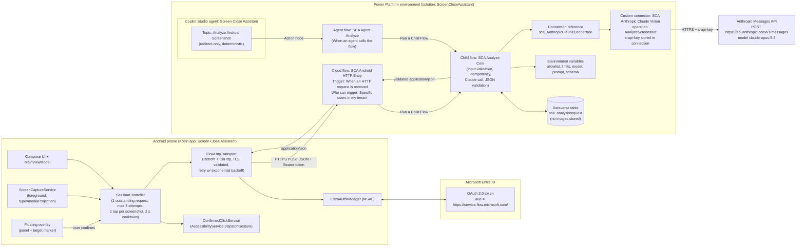

# 1. Architecture

## Request path (Android)

1. The user starts a session from the floating panel. `SessionController` hides the overlay,
   captures one frame through `MediaProjection` + `ImageReader`, and downsizes it so the long edge
   is at most 1568 px. The limit for model-native coordinates is 2576 px, so the model's
   coordinates match the pixels that were sent.
2. The app computes a 64-bit dHash and JPEG-encodes the frame in memory. Nothing is written to disk.
3. `EntraAuthManager` gets a token silently for `https://service.flow.microsoft.com//.default`.
4. `FlowHttpTransport` POSTs the request to the OAuth-protected HTTP trigger. `requestId` is the
   idempotency key, and it is also sent as `x-ms-client-request-id` and in `traceparent`.
5. **SCA Analyze Core** runs these steps in order:
   - validates every input;
   - claims `(sessionId, screenshotHash)` and `requestId` through Dataverse alternate keys;
   - calls `AnalyzeScreenshot`, using structured outputs with a strict JSON schema;
   - checks the envelope: `stop_reason` must be `end_turn`, there must be exactly one text block,
     and the output must be raw JSON;
   - runs `Parse JSON` with the schema;
   - applies the cross-field geometry and threshold rules;
   - writes the audit row;
   - returns the final document.
6. Android validates the document again with the same rules (`ResponseValidator`). If the result
   is `CLOSE`, it draws the marker and waits for the user's **confirmation** before calling
   `dispatchGesture`. It then waits 2 s and re-captures, up to 3 attempts per session.

## Copilot Studio path

The topic **Analyze Android Screenshot** takes the same inputs through a redirect, calls the
agent flow **SCA Agent Analyze**, and returns the same JSON. Both entry points share one core
flow, so validation cannot drift between them (see ADR-001).

## Trust boundaries

| Boundary | Control |
|---|---|
| Phone → Power Automate | Entra ID bearer token (audience `https://service.flow.microsoft.com/`); the trigger accepts only listed users; TLS with system CA validation; no SAS `sig=` URL (the build fails if one is configured) |
| Power Automate → Anthropic | API key held only in the custom-connector connection, reached through a solution connection reference; secure inputs/outputs hide the request in run history |
| Model output → Phone | Structured outputs, then an envelope check, then Parse JSON with the schema, then cross-field rules in the flow, then `ResponseValidator` on the device, then human confirmation |
| Screen content → Model | The system prompt treats all on-screen text as untrusted data (defence against prompt injection) |
