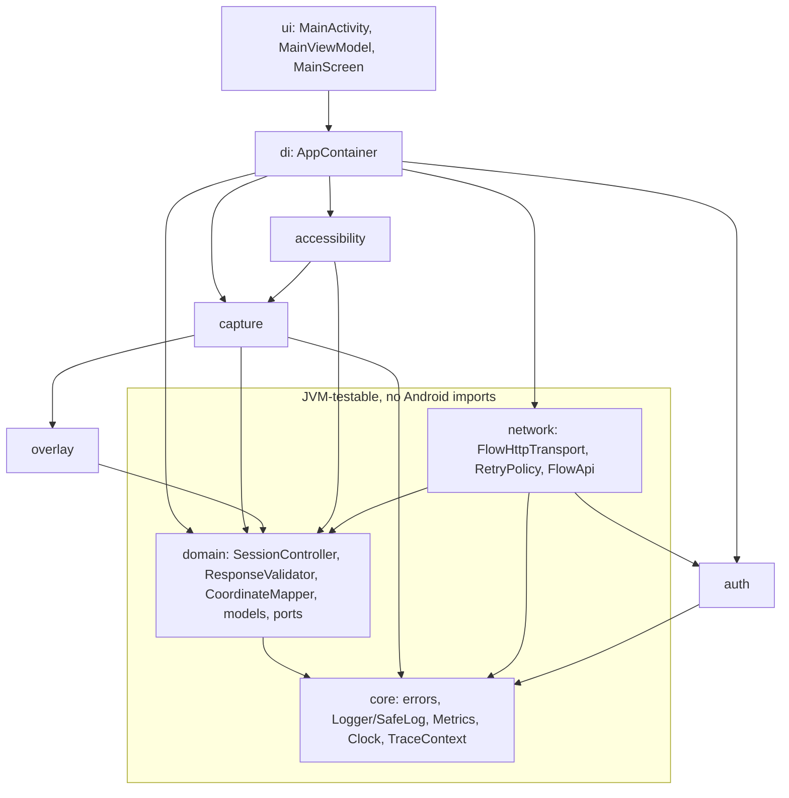

# 11–20. Android project

## 11. Project structure

```
    android/.gitignore
    android/app/build.gradle.kts
    android/app/proguard-rules.pro
    android/app/src/androidTest/java/com/schoolproject/screenclose/capture/FrameEncoderInstrumentedTest.kt
    android/app/src/main/AndroidManifest.xml
    android/app/src/main/java/com/schoolproject/screenclose/ScreenCloseApp.kt
    android/app/src/main/java/com/schoolproject/screenclose/accessibility/AccessibilityBridge.kt
    android/app/src/main/java/com/schoolproject/screenclose/accessibility/ConfirmedClickService.kt
    android/app/src/main/java/com/schoolproject/screenclose/accessibility/OverlayAwareGestureDispatcher.kt
    android/app/src/main/java/com/schoolproject/screenclose/auth/EntraAuthManager.kt
    android/app/src/main/java/com/schoolproject/screenclose/auth/TokenProvider.kt
    android/app/src/main/java/com/schoolproject/screenclose/capture/CaptureRegistry.kt
    android/app/src/main/java/com/schoolproject/screenclose/capture/DisplayContexts.kt
    android/app/src/main/java/com/schoolproject/screenclose/capture/FrameEncoder.kt
    android/app/src/main/java/com/schoolproject/screenclose/capture/PerceptualHash.kt
    android/app/src/main/java/com/schoolproject/screenclose/capture/ProjectionScreenshotSource.kt
    android/app/src/main/java/com/schoolproject/screenclose/capture/ScreenCaptureManager.kt
    android/app/src/main/java/com/schoolproject/screenclose/capture/ScreenCaptureService.kt
    android/app/src/main/java/com/schoolproject/screenclose/core/AndroidLogger.kt
    android/app/src/main/java/com/schoolproject/screenclose/core/AppConfig.kt
    android/app/src/main/java/com/schoolproject/screenclose/core/Clock.kt
    android/app/src/main/java/com/schoolproject/screenclose/core/Logger.kt
    android/app/src/main/java/com/schoolproject/screenclose/core/Metrics.kt
    android/app/src/main/java/com/schoolproject/screenclose/core/ScaError.kt
    android/app/src/main/java/com/schoolproject/screenclose/di/AppContainer.kt
    android/app/src/main/java/com/schoolproject/screenclose/domain/AnalysisModels.kt
    android/app/src/main/java/com/schoolproject/screenclose/domain/CoordinateMapper.kt
    android/app/src/main/java/com/schoolproject/screenclose/domain/Ports.kt
    android/app/src/main/java/com/schoolproject/screenclose/domain/ResponseValidator.kt
    android/app/src/main/java/com/schoolproject/screenclose/domain/SessionController.kt
    android/app/src/main/java/com/schoolproject/screenclose/domain/SessionState.kt
    android/app/src/main/java/com/schoolproject/screenclose/network/FlowApi.kt
    android/app/src/main/java/com/schoolproject/screenclose/network/FlowHttpTransport.kt
    android/app/src/main/java/com/schoolproject/screenclose/network/HttpClientFactory.kt
    android/app/src/main/java/com/schoolproject/screenclose/network/RetryPolicy.kt
    android/app/src/main/java/com/schoolproject/screenclose/overlay/OverlayContent.kt
    android/app/src/main/java/com/schoolproject/screenclose/overlay/OverlayController.kt
    android/app/src/main/java/com/schoolproject/screenclose/overlay/OverlayLifecycleOwner.kt
    android/app/src/main/java/com/schoolproject/screenclose/overlay/OverlayVisibility.kt
    android/app/src/main/java/com/schoolproject/screenclose/ui/MainActivity.kt
    android/app/src/main/java/com/schoolproject/screenclose/ui/MainScreen.kt
    android/app/src/main/java/com/schoolproject/screenclose/ui/MainViewModel.kt
    android/app/src/main/java/com/schoolproject/screenclose/ui/PermissionStatus.kt
    android/app/src/main/java/com/schoolproject/screenclose/ui/theme/Theme.kt
    android/app/src/main/res/drawable/ic_launcher_foreground.xml
    android/app/src/main/res/drawable/ic_notification.xml
    android/app/src/main/res/mipmap-anydpi-v26/ic_launcher.xml
    android/app/src/main/res/values/colors.xml
    android/app/src/main/res/values/strings.xml
    android/app/src/main/res/values/themes.xml
    android/app/src/main/res/xml/accessibility_service_config.xml
    android/app/src/main/res/xml/data_extraction_rules.xml
    android/app/src/main/res/xml/network_security_config.xml
    android/app/src/test/java/com/schoolproject/screenclose/capture/PerceptualHashTest.kt
    android/app/src/test/java/com/schoolproject/screenclose/core/SafeLogTest.kt
    android/app/src/test/java/com/schoolproject/screenclose/domain/AnalysisJsonTest.kt
    android/app/src/test/java/com/schoolproject/screenclose/domain/CoordinateMapperTest.kt
    android/app/src/test/java/com/schoolproject/screenclose/domain/ResponseValidatorTest.kt
    android/app/src/test/java/com/schoolproject/screenclose/domain/SessionControllerTest.kt
    android/app/src/test/java/com/schoolproject/screenclose/integration/FlowHttpTransportIntegrationTest.kt
    android/app/src/test/java/com/schoolproject/screenclose/integration/SessionEndToEndIntegrationTest.kt
    android/app/src/test/java/com/schoolproject/screenclose/network/RetryPolicyTest.kt
    android/app/src/test/java/com/schoolproject/screenclose/testutil/Fakes.kt
    android/build.gradle.kts
    android/gradle.properties
    android/gradle/libs.versions.toml
    android/gradlew
    android/gradlew.bat
    android/local.properties.example
    android/settings.gradle.kts
    android/testbed/build.gradle.kts
    android/testbed/src/main/AndroidManifest.xml
    android/testbed/src/main/java/com/schoolproject/adtestbed/TestbedActivity.kt
    android/testbed/src/main/res/drawable/ic_launcher_foreground.xml
    android/testbed/src/main/res/mipmap-anydpi-v26/ic_launcher.xml
    android/testbed/src/main/res/values/colors.xml
    android/testbed/src/main/res/values/strings.xml
    android/gradle/wrapper/gradle-wrapper.jar
    android/gradle/wrapper/gradle-wrapper.properties
```

### Package dependency diagram



## Where each deliverable lives

| # | Deliverable | File(s) |
|---|---|---|
| 12 | Gradle configuration | `android/settings.gradle.kts`, `android/build.gradle.kts`, `android/gradle/libs.versions.toml`, `android/app/build.gradle.kts`, `android/testbed/build.gradle.kts`, `android/gradle.properties`, `android/local.properties.example` |
| 13 | AndroidManifest.xml | `android/app/src/main/AndroidManifest.xml` (+ `res/xml/accessibility_service_config.xml`, `network_security_config.xml`, `data_extraction_rules.xml`) |
| 14 | MediaProjection foreground service | `capture/ScreenCaptureService.kt` |
| 15 | Screenshot capture | `capture/ScreenCaptureManager.kt`, `ProjectionScreenshotSource.kt`, `FrameEncoder.kt`, `PerceptualHash.kt`, `DisplayContexts.kt`, `CaptureRegistry.kt` |
| 16 | Microsoft authentication | `auth/EntraAuthManager.kt`, `auth/TokenProvider.kt` |
| 17 | Copilot Studio client (flow endpoint) | `network/FlowHttpTransport.kt`, `FlowApi.kt`, `HttpClientFactory.kt`, `RetryPolicy.kt` |
| 18 | Overlay marker and confirmation | `overlay/OverlayController.kt`, `OverlayContent.kt`, `OverlayLifecycleOwner.kt`, `OverlayVisibility.kt` |
| 19 | AccessibilityService confirmed click | `accessibility/ConfirmedClickService.kt`, `AccessibilityBridge.kt`, `OverlayAwareGestureDispatcher.kt` |
| 20 | Unit and integration tests | `app/src/test/**` (JVM: unit + MockWebServer integration), `app/src/androidTest/**` (device) |

## How the requirements map to the code

| Requirement | Enforced in |
|---|---|
| No screenshot persistence | `FrameEncoder` works in memory only and zeroes the JPEG bytes; the bitmap is recycled right after encoding; `allowBackup=false` |
| Perceptual hashing | `PerceptualHash.dHash` (ADR-006) |
| One outstanding request | `SessionController.requestGate` plus the `start()` busy check |
| One tap per screenshot | `SessionData.clickedHashes`, and a tap only from `AwaitingConfirmation` |
| Confirmation before every tap | `SessionController.confirm()` is the only path to `GestureDispatcher.tap` |
| 2 s cooldown | `SessionConfig.cooldownMillis` (the constructor rejects values under 2000) |
| At most 3 attempts | `SessionConfig.maxAttempts` (the constructor rejects values over 3) |
| Stop on WAIT, NO_ACTION, UNSAFE, ERROR | `SessionController.runAttempt` `when` block |
| Certificate-validating HTTPS | `network_security_config.xml`, `HttpClientFactory` (ADR-004) |
| No secrets in APK | `app/build.gradle.kts` `validateScaConfig()` fails the build on `sig=` or `sk-ant-` |
| No logging of image, headers, key or request | `SafeLog`, `AnalysisRequest.toString`, no `HttpLoggingInterceptor` |
